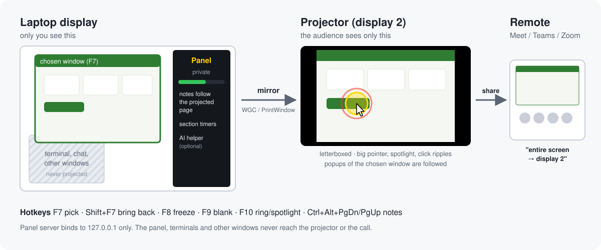
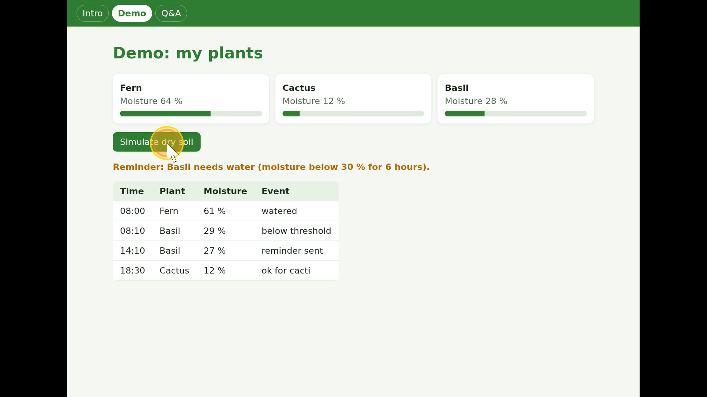
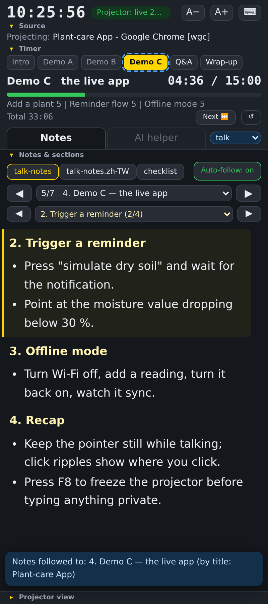
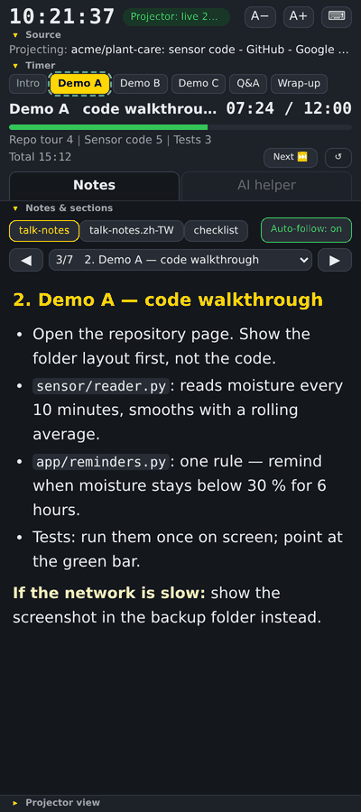

**English** | [繁體中文](README.zh-TW.md)

# presenter-sidecar

[](LICENSE)
[](requirements-windows.txt)
[](#requirements)
[](https://github.com/osisdie/presenter-sidecar/actions/workflows/ci.yml)
[](#the-panel)

**Project one window. Keep everything else private.**



presenter-sidecar mirrors a single window you choose to the projector, adds a large presenter
pointer, and gives you a private side panel on your laptop with speaker notes that follow the
page you are showing, per-section timers and an optional read-only AI helper.

| Projector: only the chosen window, letterboxed, with the pointer ring and a click ripple | Private panel: notes followed the projected tab, step bar on step 2 |
|---|---|
|  |  |

<details><summary>Auto-follow in motion (GIF)</summary>



</details>

All screenshots are mock content rendered from [`examples/`](examples/) by
[`scripts/media/render_media.py`](scripts/media/render_media.py).

## Contents

- [Why](#why)
- [How it compares](#how-it-compares)
- [Requirements](#requirements)
- [Quick start](#quick-start)
- [Hotkeys](#hotkeys)
- [Choosing the source window](#choosing-the-source-window)
- [The panel](#the-panel)
- [Try auto-follow with the demo site](#try-auto-follow-with-the-demo-site)
- [Configuration](#configuration)
- [Optional: run the panel server in WSL](#optional-run-the-panel-server-in-wsl)
- [Sharing in Meet, Teams or Zoom](#sharing-in-meet-teams-or-zoom)
- [Limitations](#limitations)
- [Privacy and security](#privacy-and-security)
- [Development](#development)
- [License](#license)

## Why

When you present from a laptop with an extended display, the projector shows a whole desktop:
notifications, the terminal you just used, a tab you did not mean to show. Duplicating the
display is worse: the audience sees your notes too.

presenter-sidecar treats the projector as a **window mirror**. You pick one window (usually a
browser); only that window is drawn on the projector, scaled to fit with black bars. Your
terminals, chat apps, notes and the panel never appear there, even if they cover the source
window on your laptop.

## How it compares

| | presenter-sidecar | OBS "windowed projector" | PowerPoint presenter view | Duplicate display |
|---|---|---|---|---|
| Shows exactly one window | ✅ | ✅ (after building a scene) | Slides only | ❌ whole screen |
| Works with any app or web page | ✅ | ✅ | ❌ | ✅ |
| Follows the window's popups (e.g. a sign-in popup) | ✅ automatic | ❌ add a new source | n/a | ✅ |
| Big pointer, spotlight, click ripples on the projector | ✅ | plugins | laser pointer | ❌ |
| Private notes that follow the projected page | ✅ | ❌ | ✅ (slides only) | ❌ |
| Per-section timers | ✅ | ❌ | one timer | ❌ |
| Setup | `start.bat` | scenes and sources | built in | built in |

OBS is the better tool for recording and streaming. PowerPoint's presenter view is the better tool
when everything is in one slide deck. presenter-sidecar is for talks and workshops that jump
between a browser, documents, a terminal demo and live apps.

## Requirements

- **Windows 10 version 2004 or later, or Windows 11**, with a second display (projector or monitor)
  in **Extend** mode.
- **Python 3.11+** for Windows ([python.org](https://www.python.org/downloads/) or the `py` launcher).
  Tested with Python 3.14.
- **Google Chrome or Microsoft Edge** for the panel window.
- Optional: the [Claude Code CLI](https://docs.claude.com/en/docs/claude-code), signed in, for the AI helper.

The mirror is Windows-only (it uses Win32 and Windows Graphics Capture). The panel server uses only
the Python standard library and runs anywhere.

## Quick start

```bat
git clone https://github.com/osisdie/presenter-sidecar.git
cd presenter-sidecar
py -m venv .venv
.venv\Scripts\python.exe -m pip install -r requirements-windows.txt
.venv\Scripts\python.exe mirror.py --selfcheck
```

Then double-click **`start.bat`**. On the first run it copies `config.example.json` to
`config.json`. It then:

1. starts the panel server on `http://127.0.0.1:8765`;
2. opens the panel as a Chrome/Edge `--app` window on the right of your laptop display, with its
   own browser profile (`%LOCALAPPDATA%\presenter-sidecar-panel`), so your normal profile is untouched;
3. starts `mirror.py`, which projects the source window to the second display.

Click the window you want to present and press **F7**. Press **Shift+F7** to place it next to the
panel. When you are done, double-click **`stop.bat`**: it only closes what `start.bat` opened.

## Hotkeys

Global: they work whichever window has focus. All of them can be changed under `hotkeys` in
`config.json` (for example if another program already uses F7; the panel tells you which keys
failed to register).

| Default | Action (`hotkeys` key) |
|---|---|
| **F7** | Project the current foreground window (`pick`) |
| **Shift+F7** | Move the source window to the laptop display, next to the panel (`bring`) |
| **F8** | Freeze / unfreeze the projector. Use it before typing anything private (`freeze`) |
| **F9** | Blank "Please wait" screen / back (`blank`) |
| **F10** | Pointer style: ring ↔ spotlight (`style`) |
| **Ctrl+Alt+PgDn / PgUp** | Next / previous notes section, without leaving your window (`next` / `prev`) |
| **Ctrl+Alt+P** | Auto-follow popups on / off (`popups`) |
| **Ctrl+Alt+L** | Confine the mouse to the laptop display on / off (`clip`) |
| **Ctrl+Alt+Q** | Quit the mirror (`quit`; the panel stays open, use `stop.bat` to close everything) |

- The big pointer is drawn only when the mouse is really over the source window, not over the
  panel or a window that covers it.
- Left click draws a red ripple, right click a blue one; while the left button is held the ring
  turns red.
- With the mouse confined (default), the audience never sees the real cursor jump onto the projector.

## Choosing the source window

- **At start**: the first window whose title contains an entry of `source_title_contains`. With the
  default empty list, the foreground window at start is used (terminals are skipped); press F7 any time.
- **Locked to the window**: once chosen, the window itself is followed. Switching tabs or changing
  the title does not lose it; moves, resizes and maximise are followed.
- **Minimised or closed**: the projector holds the last frame; only the panel shows a warning.
- **Never projected**: terminals (`never_source_classes`: Windows Terminal, console, mintty, ...),
  the panel, the desktop and the taskbar.
- **Popups** (`follow_popups`, toggle with Ctrl+Alt+P): when the source's process opens a *new*
  top-level window, such as an OAuth sign-in popup, the projector switches to it and switches back
  when it closes. Menus, tooltips, the address-bar drop-down, tool windows, windows smaller than
  `popup_min_size` and windows on other displays are ignored.
- **Capture** (`capture_backend`, default `auto`):
  1. **WGC** (Windows Graphics Capture): captures the window itself, complete even when covered;
     costs nothing while the window does not change.
  2. **PrintWindow** (`PW_RENDERFULLCONTENT`): used when WGC is not available; also works when covered.
  3. **mss**: last resort; captures the screen area only while nothing covers the window.

## The panel

A small Chrome/Edge window that only you see. Title: "Presenter Panel".

**Notes**
- Markdown files listed in `notes_files`. Each `##` heading is a section. Use ← / →, PgUp / PgDn,
  the drop-down, or Ctrl+Alt+PgDn / PgUp from anywhere. A− / A+ change the font size.
- `notes_files` reloads live: add or remove a file in `config.json` and press F5 in the panel; no restart.
- **Steps** (the second bar, under the section drop-down: ◀ `4. Recap (4/4)` ▶): inside a section,
  every paragraph that is *only* a bold numbered title is a step:

  ```markdown
  **1. Add a plant**

  - Name, species, pot size.

  **2. Trigger a reminder**
  ```

  Sections without such lines use their `###` headings instead; sections with neither hide the bar.
  - ↑ / ↓ or K / J (or the drop-down, ◀ ▶) move to the previous / next step. The step scrolls to the
    top of the notes and gets a yellow bar on its left. Scrolling by hand moves the drop-down along.
  - Changing section starts at step 1. Reloading the panel returns to the last section and step.
  - In a section without steps, ↑ / ↓ scroll the notes as before.
- **⌨ Keyboard shortcuts**: the ⌨ button next to A− / A+, or **?**, shows every key on one page.
  The global list is built from your `hotkeys` setting (keys another program has taken are marked);
  Esc, ? or ✕ closes it. ? is ignored while you type in a text box.

  Panel keys (click the panel first):

  | Key | Action |
  |---|---|
  | **← / →**, **PgUp / PgDn** | Previous / next section |
  | **↑ / ↓**, **K / J** | Previous / next step (no steps: scroll) |
  | **Home** | First section |
  | **?** | Show / hide the shortcut list (**Esc** closes) |
  | **F5** | Reload the panel (after editing notes or `config.json`) |

  Ctrl, Alt and Meta combinations are left alone, so Ctrl+Alt+PgDn / PgUp still reach the global hotkeys.
- **Auto-follow**: when the projected page changes, the notes jump to the matching section. Rules
  are in `notes_rules`, checked top to bottom, first match wins, reloaded live:
  - `title_contains` matches the tab title (a Chrome window title is the active tab's title);
  - `url_contains` matches the full URL **including `#hash`**; needs `cdp_url` (see below).
- Auto-follow jumps only when the target section changes, so manual paging is never overridden.
  Pages without a matching rule leave the notes where they are.

**Timers**
- Sections and minutes come from `pacing_file` (see [`examples/pacing.md`](examples/pacing.md)).
- Start, then "Next" per section, or click a section. The timer turns orange at 80 % and red when over.
- When you page to a notes section that belongs to another timer section, the panel offers to switch.

**AI helper** (optional, off by default)
- Ask questions about your notes or materials while presenting. It runs
  `claude -p` from the Claude Code CLI in `ai_helper.workdir` and streams the answer.
- Read-only: only `Read`, `Grep` and `Glob`; no shell, no edits, no web; secrets are denied (see
  [Privacy and security](#privacy-and-security)). The conversation continues across questions;
  "New chat" starts over.
- To enable: install and sign in to the Claude Code CLI, then in `config.json`:

  ```json
  "ai_helper": { "enabled": true, "workdir": "examples", "timeout_sec": 180 }
  ```

  Set `claude_bin` if `claude` is not on `PATH`, `model` to choose a model, and restart.
  Answers are sent to the model provider; only enable it for material you are allowed to share there.

## Try auto-follow with the demo site

No accounts needed:

```bat
.venv\Scripts\python.exe -m http.server 3000 --bind 127.0.0.1 -d examples\demo-site
```

Open `http://localhost:3000/` in a browser, press F7 on it, and click **Intro**, **Demo** and
**Q&A**. The page title changes with each section, so the notes follow using the example title
rules. To try the `#hash` URL rules, start that browser with a DevTools port and set `cdp_url`
(read the security notes first):

```bat
"C:\Program Files\Google\Chrome\Application\chrome.exe" --remote-debugging-port=9222 --user-data-dir="%TEMP%\demo-profile" http://localhost:3000/
```

```json
"cdp_url": "http://127.0.0.1:9222"
```

Self-test pages for the mirror itself are in [`web/selftest/`](web/selftest/README.md).

## Configuration

`config.example.json` is the only config in the repository; your `config.json` is gitignored.
Keys starting with `_` are comments. Coordinates are physical pixels. Restart after changes,
except `notes_files`, `pacing_file` and `notes_rules`, which reload live (press F5 in the panel for files).

| Key | Default | Meaning |
|---|---|---|
| `ui_lang` | `en` | Panel language: `en` or `zh-TW` |
| `hotkeys` | see [Hotkeys](#hotkeys) | Action → key combination; `""` disables one |
| `source_display` / `target_display` | `""` | e.g. `\\.\DISPLAY1`. Empty: primary display / first other display. Without a second display the mirror runs in a test window |
| `panel_width_ratio` / `panel_width_px` | `0.26` / `0` | Panel width; `panel_width_px` wins when > 0 |
| `panel_topmost` | `true` | Keep the panel above other windows |
| `reserve_work_area` | `false` | Register the panel strip as an AppBar so maximised windows avoid it (resizes maximised windows once at start/stop) |
| `clip_cursor_to_source` | `true` | Confine the mouse to the laptop display (toggle: Ctrl+Alt+L) |
| `source_title_contains` | `[]` | Titles to auto-select at start, in order |
| `never_source_classes` | terminals | Window classes that can never be projected |
| `capture_backend` | `auto` | `auto`, `wgc`, `printwindow` or `mss` |
| `follow_popups` / `popup_min_size` | `true` / `[320, 240]` | Popup following |
| `fps` / `smooth_scale` | `25` / `true` | Frame-rate cap, scaling quality |
| `pointer_*`, `spotlight_*`, `ripple_*` | | Pointer size, colours, spotlight, ripples |
| `blank_text` / `blank_subtext` / `font_path` | | Blank screen text and font (set `font_path` for CJK text) |
| `panel_host` / `panel_port` | `127.0.0.1` / `8765` | Panel server address (loopback only) |
| `panel_runtime` / `wsl_distro` | `windows` / `""` | Where the panel server runs |
| `panel_browser` | `""` | Chrome/Edge path for the panel; empty = auto-detect |
| `content_root` | `.` | Base folder for notes, pacing and the AI helper |
| `notes_files` / `pacing_file` | examples | Notes (Markdown) and pacing file; reload live |
| `notes_auto_follow` / `notes_follow_doc` | `true` / `""` | Auto-follow default; which notes file to follow in (empty = the one you are viewing) |
| `cdp_url` | `""` | DevTools endpoint for URL rules; empty = title rules only |
| `notes_rules` | examples | Auto-follow rules |
| `ai_helper` | `enabled: false` | `claude_bin`, `model`, `timeout_sec`, `extra_args`, `workdir`, `system_prompt` |

## Optional: run the panel server in WSL

By default `start.ps1` runs `panel_server.py` with the Windows venv Python. To run it inside WSL
instead (for example because your notes and the Claude Code CLI live there), set:

```json
"panel_runtime": "wsl",
"wsl_distro": ""
```

`wsl_distro` empty means your default distribution. The repository can live on the Windows drive
or inside WSL (open `start.bat` through `\\wsl.localhost\...`). Windows must reach the server on
`127.0.0.1`: WSL's default localhost forwarding or `networkingMode=mirrored` both work. Inside WSL
only `python3` is needed.

## Sharing in Meet, Teams or Zoom

- Share **entire screen → display 2** (the projector display). In Meet: *Present → Entire screen →
  screen 2*; in Teams: *Share → Screen → display 2*; in Zoom: *Share Screen → Screen 2*.
- **Do not** share the laptop display or a single browser tab: that would share your panel, or
  stop following when you switch windows.
- Press F9 (blank) before you start sharing, check what remote people see, then press F9 again.

## Limitations

- **One window (plus its popups).** Right-click menus, the address-bar drop-down and extension
  popups are separate small windows and are not projected. Dialogs inside a web page are part of
  the window and are projected.
- **System dialogs** (Save As, file pickers) belong to the source process but are often small or
  untitled; press F7 on them if needed, then F7 back. Windows UAC prompts, the lock screen and
  Ctrl+Alt+Del run on the secure desktop and are never captured.
- **DRM video** (streaming services) and some hardware-accelerated video capture as black.
- **HDR** on the laptop display makes captured colours look washed out; turn HDR off while presenting.
- **Aspect ratio** is kept, with black bars. Use browser zoom (Ctrl + plus) for larger text.
- **Display or scaling changes** (e.g. 125 % → 150 %, a different projector resolution): run
  `start.bat` again so coordinates are re-detected.
- The projector pointer is always an arrow; it does not change to a text cursor or hand.
- While frozen (F8), minimised or closed, no pointer is drawn on the projector.
- Do not put the source window on the projector display: the mirror covers it. The panel warns
  you; press Shift+F7.
- If `mirror.py` is killed, `stop.bat` cleans up (AppBar, mouse confinement). Run it again if a
  blank strip remains on the right.

## Privacy and security

- **Nothing leaves your computer** unless you enable the AI helper. The panel server binds to
  `127.0.0.1`, rejects requests whose `Host` is not `127.0.0.1`/`localhost` (DNS rebinding) and
  requires an `X-Panel: 1` header on every POST (other web pages cannot send it cross-site).
- **The panel is never projected**: it is excluded by title and by its own window.
- **AI helper** (off by default): the Claude Code CLI is started non-interactively with
  `--tools Read,Grep,Glob`, `--disallowedTools Bash Edit Write NotebookEdit WebFetch WebSearch`,
  `--permission-mode dontAsk`, `--strict-mcp-config`, and permission deny rules for `.env*`,
  `*.key`, `*.pem`, SSH keys, `*.local.md`, `.git/`, `config.json` and `logs/`. It runs in
  `ai_helper.workdir`; point that at your talk materials, not your home folder. Your questions and
  the files it reads are sent to the model provider.
- **CDP (`cdp_url`)** is optional. A browser started with `--remote-debugging-port` accepts commands
  from **any local process** (reading pages, cookies, running scripts). Only:
  - bind it to the local machine (the default) and use a separate presenting profile
    (`--user-data-dir`) that is not signed in to anything sensitive;
  - close that browser after the talk.

  presenter-sidecar only accepts loopback `cdp_url` values and, per tab, evaluates one read-only
  expression (`document.visibilityState`, `document.hasFocus()`, `location.href`).
- **Hidden from the audience**: source titles, warnings and notices appear only in the panel.

## Development

```bash
python -m pip install -r requirements-dev.txt
python -m pytest -q                     # unit tests, no display needed (Linux/macOS/Windows)
scripts/check/install-hooks.sh          # pre-commit: gitleaks + private-term scan
scripts/check/scan-private.sh --all
```

| Path | What |
|---|---|
| `mirror.py` | Windows: source selection, capture, scaling, projector window, pointer, hotkeys, AppBar |
| `panel_server.py` | Panel web server and AI helper backend (standard library only) |
| `presenter_sidecar/` | Pure modules: geometry, window rules, notes rules, hotkeys, config, CDP, messages |
| `web/` | Panel front end (`index.html`, `panel.js`, `panel.css`) and `selftest/` pages |
| `examples/` | Mock talk notes (English and 繁體中文), checklist, pacing, demo site |
| `start.ps1` / `stop.ps1` (`.bat`) | Start and stop everything |
| `tests/` | Unit tests |
| `scripts/media/` | Re-generates the mock screenshots in `docs/media/` (headless; needs `playwright` and `pillow`) |

See [CONTRIBUTING.md](CONTRIBUTING.md) and [SECURITY.md](SECURITY.md).

## License

[MIT](LICENSE) © osisdie. Third-party packages and their licences:
[THIRD_PARTY.md](THIRD_PARTY.md) (pygame-ce is LGPL-2.1, used as an unmodified dynamic library).
