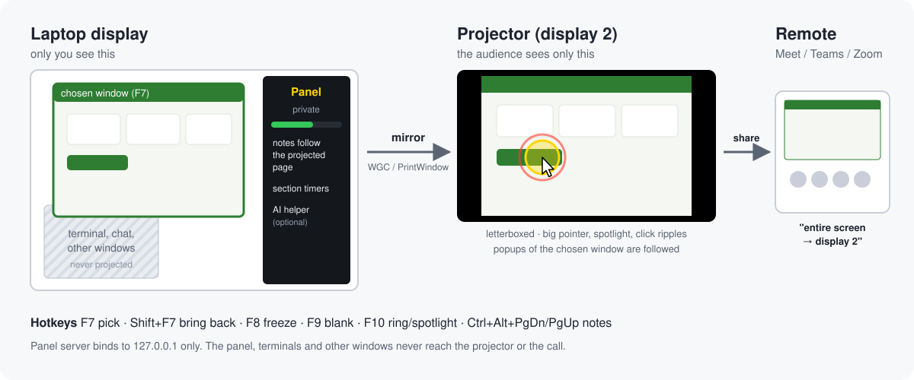
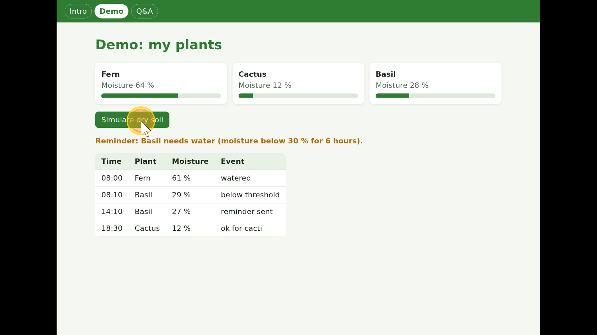
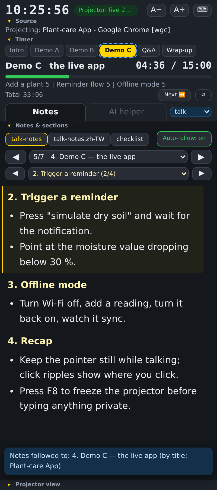
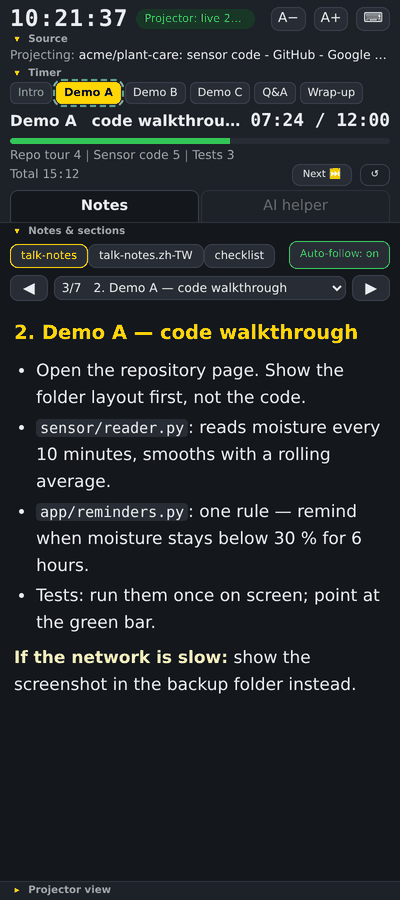

[English](README.md) | **繁體中文**

# presenter-sidecar

[](LICENSE)
[](requirements-windows.txt)
[](#系統需求)
[](https://github.com/osisdie/presenter-sidecar/actions/workflows/ci.yml)
[](#講者面板)

**只投影一個視窗，其他的都留在自己的螢幕上。**



presenter-sidecar 把你選定的「一個視窗」即時投到投影機，加上大游標；筆電上另有一個只有你看得到的側邊面板：
會跟著投影頁面自動翻頁的講稿、各段計時，以及可選用的唯讀 AI 助手。

| 投影：只有選定的視窗，等比縮放加黑邊，加上游標光圈與點擊波紋 | 私人面板：講稿跟著投影的分頁切換 |
|---|---|
|  |  |

<details><summary>自動跟隨動畫（GIF）</summary>



</details>

所有截圖都是用 [`scripts/media/render_media.py`](scripts/media/render_media.py) 從 [`examples/`](examples/) 的虛構內容產生的。

## 目錄

- [為什麼需要它](#為什麼需要它)
- [和其他做法比較](#和其他做法比較)
- [系統需求](#系統需求)
- [快速開始](#快速開始)
- [熱鍵](#熱鍵)
- [選擇投影來源](#選擇投影來源)
- [講者面板](#講者面板)
- [情境（profile）：課程和會議用同一個面板](#情境profile課程和會議用同一個面板)
- [用範例網站試講稿自動跟隨](#用範例網站試講稿自動跟隨)
- [設定](#設定)
- [選用：在 WSL 執行面板伺服器](#選用在-wsl-執行面板伺服器)
- [在 Meet、Teams、Zoom 分享](#在-meetteamszoom-分享)
- [限制](#限制)
- [隱私與安全](#隱私與安全)
- [開發](#開發)
- [授權](#授權)

## 為什麼需要它

用筆電接投影機、設成「延伸」時，投影上是一整個桌面：通知、剛用過的終端機、不小心切到的分頁都會被看到。
設成「同步顯示」更糟，觀眾連你的講稿都看得到。

presenter-sidecar 把投影當成「視窗鏡像」：你選一個視窗（通常是瀏覽器），投影上就只畫那個視窗，等比縮放、加黑邊。
終端機、聊天軟體、講稿和面板永遠不會出現在投影上，就算它們在筆電上蓋住了來源視窗也一樣。

## 和其他做法比較

| | presenter-sidecar | OBS「視窗投影」 | PowerPoint 簡報者檢視畫面 | 同步顯示 |
|---|---|---|---|---|
| 只顯示一個視窗 | ✅ | ✅（要先建場景） | 只有投影片 | ❌ 整個螢幕 |
| 任何程式、任何網頁都能用 | ✅ | ✅ | ❌ | ✅ |
| 自動跟隨彈窗（例如登入授權視窗） | ✅ 自動 | ❌ 要另外加來源 | 不適用 | ✅ |
| 投影上的大游標、聚光燈、點擊波紋 | ✅ | 要裝外掛 | 雷射筆 | ❌ |
| 跟著投影頁面切換的私人講稿 | ✅ | ❌ | ✅（只限投影片） | ❌ |
| 各段計時 | ✅ | ❌ | 一個計時器 | ❌ |
| 設定 | `start.bat` | 場景與來源 | 內建 | 內建 |

錄影、直播用 OBS 比較好；全部內容都在一份投影片裡時，PowerPoint 的簡報者檢視畫面比較好。
presenter-sidecar 適合在瀏覽器、文件、終端機示範和實際 App 之間來回切換的演講與工作坊。

## 系統需求

- **Windows 10 2004 以上或 Windows 11**，接第二個螢幕（投影機或螢幕），顯示模式設為**延伸**。
- Windows 版 **Python 3.11 以上**（[python.org](https://www.python.org/downloads/) 或 `py` 啟動器）。以 Python 3.14 測試。
- **Google Chrome 或 Microsoft Edge**（當作面板視窗）。
- 選用：已登入的 [Claude Code CLI](https://docs.claude.com/en/docs/claude-code)（AI 助手用）。

投影鏡像只能在 Windows 上執行（用到 Win32 和 Windows Graphics Capture）。面板伺服器只用 Python 標準函式庫，哪裡都能跑。

## 快速開始

```bat
git clone https://github.com/osisdie/presenter-sidecar.git
cd presenter-sidecar
py -m venv .venv
.venv\Scripts\python.exe -m pip install -r requirements-windows.txt
.venv\Scripts\python.exe mirror.py --selfcheck
```

接著雙擊 **`start.bat`**。第一次執行會把 `config.example.json` 複製成 `config.json`，然後：

1. 啟動面板伺服器 `http://127.0.0.1:8765`；
2. 在筆電螢幕右側開一個 Chrome／Edge `--app` 視窗當面板，使用獨立的瀏覽器設定檔
   （`%LOCALAPPDATA%\presenter-sidecar-panel`），不影響你平常的瀏覽器；
3. 啟動 `mirror.py`，把來源視窗投到第二個螢幕。

點一下要投影的視窗，按 **F7**；按 **Shift+F7** 把它擺到面板左邊。結束時雙擊 **`stop.bat`**，只會關掉 `start.bat` 開的東西。

## 熱鍵

全域熱鍵，焦點在哪個視窗都有效。全部可以在 `config.json` 的 `hotkeys` 修改（例如 F7 已被其他程式佔用時；
註冊失敗的熱鍵會顯示在面板上）。

| 預設 | 作用（`hotkeys` 的鍵） |
|---|---|
| **F7** | 把目前的前景視窗設為投影來源（`pick`） |
| **Shift+F7** | 把來源視窗搬回筆電螢幕、面板左邊（`bring`） |
| **F8** | 凍結／解除凍結投影。要輸入私人資料前先按（`freeze`） |
| **F9** | 「請稍候」畫面／切回（`blank`） |
| **F10** | 游標樣式：光圈 ↔ 聚光燈（`style`） |
| **Ctrl+Alt+PgDn／PgUp** | 講稿下一節／上一節，不必切到面板（`next`／`prev`） |
| **Ctrl+Alt+P** | 自動跟隨彈窗：開／關（`popups`） |
| **Ctrl+Alt+L** | 滑鼠鎖在筆電螢幕：開／關（`clip`） |
| **Ctrl+Alt+Q** | 結束投影（`quit`；面板還會開著，全部關閉請用 `stop.bat`） |

- 大游標只在**游標真的在來源視窗上**時才畫；游標在面板或擋在前面的視窗上時不畫。
- 左鍵是紅色波紋、右鍵是藍色波紋；按住左鍵時光圈外框變紅。
- 滑鼠鎖定（預設開）時，觀眾不會看到真游標跑到投影上。

## 選擇投影來源

- **啟動時**：找標題包含 `source_title_contains` 任一項的第一個視窗。預設是空清單，會用啟動當下的前景視窗
  （終端機除外）；隨時可以按 F7 換。
- **鎖定視窗本身**：選定後就跟著那個視窗，切分頁、標題改變都不會跑掉；移動、縮放、最大化都會跟上。
- **縮小或關閉**：投影停在最後一格，只有面板會顯示提醒。
- **永遠不投影**：終端機類（`never_source_classes`：Windows Terminal、主控台、mintty…）、面板、桌面和工作列。
- **彈窗**（`follow_popups`，Ctrl+Alt+P 切換）：來源視窗的同一個程式**新開**一個獨立視窗（例如 OAuth 登入視窗）時，
  投影自動切過去，關掉後切回來源。選單、提示框、網址列下拉清單、工具視窗、小於 `popup_min_size` 的視窗、
  在其他螢幕上的視窗都不會被跟。
- **擷取方式**（`capture_backend`，預設 `auto`）：
  1. **WGC**（Windows Graphics Capture）：直接擷取視窗本身，被擋住也完整；畫面沒變化時不耗 CPU。
  2. **PrintWindow**（`PW_RENDERFULLCONTENT`）：WGC 不能用時改用這個，被擋住也完整。
  3. **mss**：最後的備援，只在視窗完全沒被擋住時擷取。

## 講者面板

只有你看得到的 Chrome／Edge 小視窗，標題是「Presenter Panel」。

**講稿**
- 讀 `notes_files` 列出的 Markdown 檔，每個 `##` 標題是一節。用 ←／→、PgUp／PgDn、下拉選單，
  或在任何地方按 Ctrl+Alt+PgDn／PgUp 翻頁。A−／A+ 調字體大小。
- `notes_files` 存檔即生效：在 `config.json` 加減講稿檔，回面板按 F5 就好，不用重新啟動。
- **步驟導覽**（節選單下面第二排：◀ `4. 重點回顧（4/4）` ▶）：一節裡面，**整段只有一行粗體編號標題**
  的段落就是一步：

  ```markdown
  **1. 新增一盆植物**

  - 名字、品種、盆子大小。

  **2. 觸發一次提醒**
  ```

  沒有這種段落的節，改用 `###` 小標當步驟；兩種都沒有就不顯示這一排。
  半形句點後面要空一格才算步驟（`**2.5 million**` 不算）；全形 `3．` 後面可以不空格。
  一步到下一步、標題、`---` 分隔線或 `>` 引言為止：步驟後面的引言不算在這一步裡（適合放不念出來的補充）。
  - 用 ↑／↓ 或 K／J（或下拉選單、◀ ▶）換上一步／下一步。選到的那一步會捲到講稿最上面，左邊出現黃色框線；
    自己捲動時，下拉選單也會跟著換。
  - 某一步比講稿畫面還高時：↓ 先在這一步裡往下捲（每次最多 80% 畫面，捲到這一步結尾為止），再換下一步；↑ 也一樣先捲回這一步的標題。
  - 在最後一步按 ↓，會繼續往下捲到這一節結尾。剛進到一節、步驟 1 沒有整個出現在畫面上時，第一次按 ↓ 先把步驟 1 捲上來。
    標題已經捲到上面看不到時（例如在這一節結尾），按 ↑ 先回到這一步的標題。
  - 換節時從步驟 1 開始。面板重新載入時，回到上次的講稿檔、那一節、那一步（依講稿路徑記住，`notes_files` 增加或調換順序也不會亂）。
  - 沒有步驟的節，↑／↓ 照舊捲動講稿。
- **⌨ 快捷鍵一覽**：按 A−／A+ 旁邊的 ⌨，或按 **?**，所有按鍵列在同一頁。全域熱鍵列的是 `mirror.py` 啟動時實際註冊的
  （被其他程式佔用的會標出來）；mirror 未連線時改列 `hotkeys` 設定。mirror 只在啟動時讀 `hotkeys`，改熱鍵需重開 mirror。
  按 Esc、? 或 ✕ 關閉，焦點回到打開前的位置。在輸入框打字時，? 不會觸發。

  面板按鍵（先點一下面板）：

  | 按鍵 | 動作 |
  |---|---|
  | **←／→**、**PgUp／PgDn** | 上一節／下一節 |
  | **↑／↓**、**K／J** | 上一步／下一步（沒有步驟時：捲動） |
  | **Home** | 回到第一節 |
  | **?** | 開／關快捷鍵一覽（**Esc** 關閉） |
  | **F5** | 重新載入面板（改了講稿或 `config.json` 後） |

  Ctrl、Alt、Meta 組合鍵不會被面板攔下，所以 Ctrl+Alt+PgDn／PgUp 仍交給全域熱鍵。
- **自動跟隨**：投影的頁面換了，講稿就跳到對應段落。規則在 `notes_rules`，由上往下比對、第一個符合的生效，存檔即生效：
  - `title_contains` 比對分頁標題（Chrome 的視窗標題就是目前分頁的標題）；
  - `url_contains` 比對完整網址，**含 `#錨點`**；需要 `cdp_url`（見下方）。
- 只有「對應的段落改變」時才跳，所以手動翻頁不會被蓋掉；沒有對應規則的頁面不會讓講稿跳動。

**可收合的區塊**
- 面板的每個區塊都有一列標題：點一下（或用 Tab 移到標題再按 Enter／空白鍵）就能展開 ▾ 或收合 ▸。
  區塊有：**投影來源**（投影中的視窗與警告）、**計時**（段落按鈕、進度條、全場時間）、講稿分頁的
  **講稿與章節**（講稿檔、自動跟隨、章節與步驟列）、AI 助手分頁的**對話**，以及最下方的**投影畫面**。
- 收合後標題列會留一行摘要：投影來源標題（有警告時改顯示警告，所以警告不會被藏起來）、目前段落計時、
  `3/7 Demo B · 2. 步驟（2/4）`、凍結／請稍候。
- 講稿永遠佔滿剩下的高度。區塊收起來時，按鍵（←／→、↑／↓、J／K、?、Esc）和步驟自動對位都照常運作。
  每個區塊的開合狀態會記住（依面板的瀏覽器設定檔）。第一次使用時，除了投影畫面以外都是展開的。

**投影畫面**（面板最下方，預設收合）
- 小小一張「觀眾現在看到什麼」：按 F8 凍結時是凍結的畫面、按 F9 時是「請稍候」畫面，也包含自動跟隨的彈窗。
  這不是即時影像：mirror.py 每 `preview_interval_sec`（預設 2 秒）存一張小 JPEG（`preview_width`，預設 480 px），
  畫面沒變就不寫檔。
- 展開且面板看得到時，約每 2 秒更新一次；收合或面板被遮住時完全不載入。
  會顯示多久以前（「3 秒前」）和**凍結**／**請稍候**標籤。畫面超過 10 秒沒更新、或 mirror 沒連線時會變灰並加註
  （保留最後一張，變灰）。
- `"preview_interval_sec": 0` 會在 mirror.py 關掉這個功能（需重開 mirror）。預覽出錯時（例如 JPEG 編碼失敗）
  只會關掉預覽（顯示「預覽已關閉」），投影照常。
- 講稿至少保留視窗四分之一的高度：面板很矮時，先縮小預覽畫面，最小只剩標題列。

**計時**
- 段落和分鐘數來自 `pacing_file`（格式見 [`examples/pacing.md`](examples/pacing.md)），或用 `pacing_notes`
  直接從講稿讀（見[情境](#情境profile課程和會議用同一個面板)）。
- 按「開始」，每段按「下一段」，或直接點段落。用掉 80% 變橘色，超時變紅色。
- 翻到屬於另一段的講稿時，面板會問你要不要把計時切過去。

**AI 助手**（選用，預設關閉）
- 演講中可以問講稿或教材的問題。背景是在 `ai_helper.workdir` 執行 Claude Code CLI 的 `claude -p`，答案串流顯示。
- 唯讀：只能用 `Read`、`Grep`、`Glob`；不能執行指令、不能改檔、不能上網；秘密檔案在工具層就被擋
  （見[隱私與安全](#隱私與安全)）。會延續同一段對話，按「新對話」重新開始。
- 啟用方式：安裝並登入 Claude Code CLI，在 `config.json` 設定：

  ```json
  "ai_helper": { "enabled": true, "workdir": "examples", "timeout_sec": 180 }
  ```

  `claude` 不在 `PATH` 上時設定 `claude_bin`；要指定模型設定 `model`；改完重新啟動。
  問題和它讀到的檔案會送到模型供應商，只在你可以分享這些內容時啟用。

## 情境（profile）：課程和會議用同一個面板

一個**情境**（profile）就是一組講稿檔、計時段落（pacing）和自動跟隨規則。上方的段落計時、講稿和跟隨規則
永遠屬於同一個情境，所以不會出現「上面是課程計時、下面是會議講稿」對不上的情況。

- 最上層的 `notes_files`、`pacing_file`／`pacing_notes`、`notes_rules` 就是第一個情境，名稱是 `profile_name`
  （0.3.0 以前的設定檔就是只有一個情境）。其他情境加在 `profiles`。如果最上層的 `notes_files` 是空的、
  `profiles` 又有內容，第一個情境就會被略過（伺服器記錄會寫出來）；沒有名稱或名稱重複的情境也一樣會被略過。

  ```json
  "profile_name": "talk",
  "profiles": [
    { "name": "meeting",
      "notes_files": ["examples/notes/meeting.md"],
      "pacing_notes": "examples/notes/meeting.md",
      "notes_rules": [{ "title_contains": "Sprint board", "section_heading_contains": "Board walk" }] }
  ]
  ```
- **用講稿當計時**（`pacing_notes`，`pacing_file` 空白時使用）：每個 `##` 段落裡有一行**開頭就是**
  `建議時間：` 或 `Suggested time:`，就是一個計時段落，依序排列。前面可以有清單符號，可以加粗、寫「約」、`~`，
  或寫 `10–15` 這種範圍（取第一個數字），也可以用小時：`約 15 分鐘`、`~15 min`、`1.5 小時`、`1 小時 30 分`。
  寫在句子中間、`>` 引言或程式碼區塊裡的不算，時間是 0 也不算。`Part 2: Board walk` 的按鈕會顯示 `Part 2`；
  同一個標題出現兩次會有兩個計時。沒有這一行的段落（例如附錄）不計時。範例見 [`examples/notes/meeting.md`](examples/notes/meeting.md)。
- **切換**：講稿／AI 助手分頁列最右邊的小選單（有兩個以上情境才顯示）。講稿清單、段落計時和跟隨規則一起換。
  每個情境各自保留計時、開著的講稿檔和位置，切回來時另一個情境的計時還在繼續跑。
- **跨情境自動跟隨**（`profile_auto_switch`，預設開）：先比對目前情境的規則；都不符合時才比對其他情境，
  符合就切換情境並跳出提示。關掉它就會一直留在你選的情境。
- **用指定情境啟動**：`start.bat -Profile meeting`（或 `start.ps1 -Profile meeting`）、`panel_server.py --profile meeting`、
  環境變數 `PRESENTER_PROFILE`、設定檔的 `"profile"`，依序優先；都沒有就用第一個情境。在 `start.bat` 旁邊放一個 `meeting.bat`：

  ```bat
  @echo off
  call "%~dp0start.bat" -Profile meeting
  ```

  面板伺服器已經在跑時，`-Profile` 會請每個開著的面板視窗切換一次；之後按 F5 會保留你手動選的情境。
  啟動情境（`-Profile`、`--profile`、`PRESENTER_PROFILE` 或設定檔的 `"profile"`）每次啟動伺服器只套用一次；
  這些都沒設定時重開伺服器，面板會留在原本顯示的情境。之後才新開的面板視窗（不是按 F5）也會套用一次這次啟動的情境，
  即使另一個視窗已經手動切到別的情境。`.bat` 裡的情境名稱建議用英文：用中文名稱時，檔案要存成 UTF-8，並在 `call` 前加
  `chcp 65001 >nul`。
- 在 `config.json` 新增、改名或刪除情境，小選單會自己更新（不用按 F5）；情境裡的講稿、計時和規則一樣存檔即生效。

## 用範例網站試講稿自動跟隨

不需要任何帳號：

```bat
.venv\Scripts\python.exe -m http.server 3000 --bind 127.0.0.1 -d examples\demo-site
```

用瀏覽器開 `http://localhost:3000/`，在上面按 F7，再依序點 **Intro**、**Demo**、**Q&A**。
頁面標題會跟著段落改變，所以用範例的標題規則就能讓講稿跟著跳。想試 `#錨點` 網址規則，
用 DevTools 連接埠啟動那個瀏覽器並設定 `cdp_url`（請先讀安全說明）：

```bat
"C:\Program Files\Google\Chrome\Application\chrome.exe" --remote-debugging-port=9222 --user-data-dir="%TEMP%\demo-profile" http://localhost:3000/
```

```json
"cdp_url": "http://127.0.0.1:9222"
```

測試投影鏡像本身的自我測試頁在 [`web/selftest/`](web/selftest/README.md)。

## 設定

repo 裡只有 `config.example.json`；你自己的 `config.json` 不進版控。以 `_` 開頭的鍵是註解。
座標一律是實體像素。改完要重新啟動；`notes_files`、`pacing_file`、`pacing_notes`、`notes_rules`、`profile_name`、
`profiles`、`profile_auto_switch` 例外，存檔即生效（講稿檔清單改了要在面板按 F5）。

| 鍵 | 預設 | 說明 |
|---|---|---|
| `ui_lang` | `en` | 面板語言：`en` 或 `zh-TW` |
| `hotkeys` | 見[熱鍵](#熱鍵) | 動作 → 按鍵組合；`""` 代表停用 |
| `source_display`／`target_display` | `""` | 例如 `\\.\DISPLAY1`。空白：主螢幕／第一個其他螢幕。沒有第二個螢幕時用視窗模式測試 |
| `panel_width_ratio`／`panel_width_px` | `0.26`／`0` | 面板寬度；`panel_width_px` 大於 0 時優先 |
| `panel_topmost` | `true` | 面板永遠在最上層 |
| `reserve_work_area` | `false` | 用 AppBar 保留面板區，最大化的視窗會避開面板（啟動／關閉時已最大化的視窗會縮放一次） |
| `clip_cursor_to_source` | `true` | 滑鼠鎖在筆電螢幕（Ctrl+Alt+L 切換） |
| `source_title_contains` | `[]` | 啟動時自動選取的標題關鍵字，依序比對 |
| `never_source_classes` | 終端機類 | 永遠不能投影的視窗類別 |
| `capture_backend` | `auto` | `auto`、`wgc`、`printwindow` 或 `mss` |
| `follow_popups`／`popup_min_size` | `true`／`[320, 240]` | 彈窗跟隨 |
| `fps`／`smooth_scale` | `25`／`true` | 更新率上限、縮放品質 |
| `preview_interval_sec` | `2` | 給面板的投影畫面預覽，每幾秒存一張；`0` 關閉（最少 0.5） |
| `preview_width`／`preview_quality` | `480`／`70` | 預覽寬度（px，不會放大）與 JPEG 品質（10–95） |
| `pointer_*`、`spotlight_*`、`ripple_*` | | 游標大小、顏色、聚光燈、波紋 |
| `blank_text`／`blank_subtext`／`font_path` | | 「請稍候」畫面的文字與字型（中文請設定 `font_path`，例如 `C:\\Windows\\Fonts\\msjh.ttc`） |
| `panel_host`／`panel_port` | `127.0.0.1`／`8765` | 面板伺服器位址（只能是本機） |
| `panel_runtime`／`wsl_distro` | `windows`／`""` | 面板伺服器在哪裡執行 |
| `panel_browser` | `""` | 面板用的 Chrome／Edge 路徑；空白＝自動尋找 |
| `content_root` | `.` | 講稿、計時檔與 AI 助手的根目錄 |
| `notes_files`／`pacing_file` | 範例 | 講稿（Markdown）與計時檔；存檔即生效。路徑照寫的信任（`config.json` 是你自己的檔）：可以用 `..` 和絕對路徑 |
| `notes_auto_follow`／`notes_follow_doc` | `true`／`""` | 自動跟隨預設值；要在哪份講稿裡跳（空白＝目前在看的那份） |
| `cdp_url` | `""` | 網址規則用的 DevTools 位址；空白＝只用標題規則 |
| `notes_rules` | 範例 | 自動跟隨規則 |
| `pacing_notes` | `""` | `pacing_file` 空白時，用這個講稿檔當計時（每個 `##` 段落寫 `建議時間：約 N 分鐘`） |
| `profile_name`／`profiles` | `default`／`[]` | 上面這些設定組成的情境名稱；其他情境，各有 `name`、`notes_files`、`pacing_file` 或 `pacing_notes`、`notes_rules`、`notes_follow_doc`（見[情境](#情境profile課程和會議用同一個面板)） |
| `profile` | `""` | 啟動時的情境（空白＝第一個）；`--profile`／`PRESENTER_PROFILE`／`start.bat -Profile` 優先 |
| `profile_auto_switch` | `true` | 投影的頁面符合其他情境的規則時，自動跟隨可以切換情境 |
| `ai_helper` | `enabled: false` | `claude_bin`、`model`、`timeout_sec`、`extra_args`、`workdir`、`system_prompt` |

## 選用：在 WSL 執行面板伺服器

預設 `start.ps1` 用 Windows venv 的 Python 執行 `panel_server.py`。如果你的講稿和 Claude Code CLI 都在 WSL 裡，可以改成：

```json
"panel_runtime": "wsl",
"wsl_distro": ""
```

`wsl_distro` 空白代表預設的發行版。repo 放在 Windows 磁碟或 WSL 裡都可以（在 WSL 裡時從 `\\wsl.localhost\...` 開 `start.bat`）。
Windows 必須能連到 WSL 的 `127.0.0.1`：WSL 預設的 localhost 轉送或 `networkingMode=mirrored` 都可以。WSL 端只需要 `python3`。

## 在 Meet、Teams、Zoom 分享

- 分享**「整個畫面 → 螢幕 2」**（投影螢幕）。Meet：*分享螢幕 → 整個螢幕 → 第 2 個*；
  Teams：*分享 → 螢幕 → 螢幕 2*；Zoom：*分享螢幕 → 螢幕 2*。
- **不要**分享筆電螢幕，也不要只分享單一分頁：前者會把面板一起分享出去，後者切換視窗時就不會跟著換。
- 開始分享前先按 F9 切到「請稍候」，確認遠端看到的畫面正確，再按 F9 切回來。

## 限制

- **只投一個視窗（加上它的彈窗）。** 右鍵選單、網址列下拉清單、擴充功能彈出框是另外的小視窗，不會出現在投影上；
  網頁裡面的對話框屬於同一個視窗，會正常出現。
- **系統對話框**（另存新檔、選檔案）常常很小或沒有標題，不一定會被跟隨；需要時按 F7 切過去，做完再按 F7 切回來。
  UAC 提示、鎖定畫面、Ctrl+Alt+Del 在安全桌面上，永遠擷取不到。
- **DRM 影片**（串流平台）和部分硬體加速影片會變成黑畫面。
- 筆電開了 **HDR** 時擷取的顏色會偏灰，演講時請關掉 HDR。
- 會保持**原比例**並加黑邊；想讓字大一點，在瀏覽器按 Ctrl＋加號放大。
- **改了縮放比例或投影解析度**（例如 125% 改 150%）：重新執行 `start.bat`，座標才會重新偵測。
- 投影上的游標一律是箭頭，不會變成文字游標或手指。
- 凍結（F8）、來源縮小或關閉時，投影上不畫游標。
- 來源視窗不要放在投影螢幕上，會被投影畫面蓋住；面板會提醒，按 Shift+F7 搬回來。
- `mirror.py` 被強制結束時，`stop.bat` 會補做清理（AppBar、滑鼠鎖定）；右側還留著空白區就再執行一次。

## 隱私與安全

- **沒有啟用 AI 助手時，資料不會離開你的電腦。** 面板伺服器只綁 `127.0.0.1`，`Host` 標頭不是 `127.0.0.1`／`localhost`
  的請求一律拒絕（防 DNS rebinding），每個 POST 都要帶 `X-Panel: 1`（其他網頁無法跨站送出）。
- **面板永遠不會被投影**：依標題和視窗本身排除。
- **AI 助手**（預設關閉）：Claude Code CLI 以非互動方式啟動，參數包括 `--tools Read,Grep,Glob`、
  `--disallowedTools Bash Edit Write NotebookEdit WebFetch WebSearch`、`--permission-mode dontAsk`、`--strict-mcp-config`，
  並用權限規則擋掉 `.env*`、`*.key`、`*.pem`、SSH 金鑰、`*.local.md`、`.git/`、`config.json` 和 `logs/`。
  它在 `ai_helper.workdir` 裡執行，請指向你的演講資料夾，不要指向整個家目錄。你的問題和它讀到的檔案會送到模型供應商。
- **CDP（`cdp_url`）** 是選用的。用 `--remote-debugging-port` 啟動的瀏覽器會接受**本機任何程式**的指令
  （讀網頁、讀 cookie、執行腳本）。請只：
  - 綁在本機（預設就是），並使用獨立的投影用設定檔（`--user-data-dir`），不要登入任何敏感帳號；
  - 演講結束就關掉那個瀏覽器。

  presenter-sidecar 只接受本機（loopback）的 `cdp_url`，而且每個分頁只執行一個唯讀運算式
  （`document.visibilityState`、`document.hasFocus()`、`location.href`）。
- **觀眾看不到**：來源標題、警告和提示只會出現在面板上。
- **投影畫面預覽**：`logs/mirror.preview.jpg` 是投影內容的縮小版，所以裡面有螢幕畫面。它只留在這台電腦的 `logs/`
  （已列入 .gitignore，AI 助手也被禁止讀取），不會上傳，每幾秒原地覆蓋，mirror 啟動和結束時都會刪掉（強制關閉後，`stop.bat` 也會刪）。
  面板伺服器只把它給 `127.0.0.1` 的頁面，並加上 `Cache-Control: no-store` 和
  `Cross-Origin-Resource-Policy: same-origin`（其他網站無法嵌入）。設定 `"preview_interval_sec": 0` 就完全不寫這個檔。

## 開發

```bash
python -m pip install -r requirements-dev.txt
python -m pytest -q                     # 單元測試，不需要螢幕（Linux／macOS／Windows）
node --test tests/js/*.test.js          # 面板的步驟規則（web/steps.js）跑共用測資，以及 web/view.js
# headless 面板測試（tests/test_panel_ui.py；沒裝 Playwright 會自動略過，CI 的 ui job 會跑）
python -m pip install playwright pillow && python -m playwright install chromium
scripts/check/install-hooks.sh          # pre-commit：gitleaks＋私人字詞掃描
scripts/check/scan-private.sh --all
```

| 路徑 | 內容 |
|---|---|
| `mirror.py` | Windows：選來源、擷取、縮放、投影視窗、游標、熱鍵、AppBar |
| `panel_server.py` | 面板網頁伺服器與 AI 助手後端（只用標準函式庫） |
| `presenter_sidecar/` | 純邏輯模組：幾何、視窗規則、講稿規則、情境、熱鍵、設定、CDP、預覽、訊息 |
| `web/` | 面板前端（`index.html`、`panel.js`、`panel.css`；不碰 DOM 的 `md.js`、`steps.js`、`view.js` 可在 node 測試）與 `selftest/` 測試頁 |
| `examples/` | 虛構的講稿（英文與繁體中文）、會議講稿（第二個情境）、檢查清單、計時檔、範例網站 |
| `start.ps1`／`stop.ps1`（`.bat`） | 啟動與關閉全部 |
| `tests/` | 單元測試；裝了 Playwright 時，`test_panel_ui.py` 會用 headless Chromium 操作面板 |
| `scripts/media/` | 重新產生 `docs/media/` 的範例截圖（headless；需要 `playwright` 和 `pillow`） |

另見 [CONTRIBUTING.md](CONTRIBUTING.md) 和 [SECURITY.md](SECURITY.md)。

## 授權

[MIT](LICENSE) © osisdie。第三方套件與授權見 [THIRD_PARTY.md](THIRD_PARTY.md)
（pygame-ce 是 LGPL-2.1，以未修改的動態函式庫方式使用）。
